<div align="center">



<br/><br/>

<p align="center">
  <code>ZURICH · AMSTERDAM · EINDHOVEN</code> &nbsp;◆&nbsp;
  <a href="https://github.com/marketplace/actions/zeroslop-by-ribbsaeter-systems"><b>ZeroSlop™ Action</b></a> &nbsp;◆&nbsp;
  <a href="https://github.com/apps/zeroslop-engine"><b>1-Click GitHub App</b></a> &nbsp;◆&nbsp;
  <a href="https://hf.co/spaces/Patrickribbsaeter/zeroslop-kv-cache-estimator"><b>KV Cache Estimator (Hugging Face)</b></a> &nbsp;◆&nbsp;
  <a href="https://www.ribbsaetersystems.com/inference"><b>Inference Runtime</b></a> &nbsp;◆&nbsp;
  <a href="https://www.ribbsaetersystems.com/zeroslop"><b>Live Simulator</b></a> &nbsp;◆&nbsp;
  <a href="FAQ.md"><b>FAQ</b></a> &nbsp;◆&nbsp;
  <a href="SECURITY.md"><b>Security</b></a> &nbsp;◆&nbsp;
  <a href="https://www.ribbsaetersystems.com"><b>ribbsaetersystems.com</b></a>
</p>

<br/>


<br/><br/>

<a href="#quickstart">
  
</a>
&nbsp;
<a href="#choose-your-package">
  
</a>

<br/><br/>

<a href="https://www.ribbsaetersystems.com/zeroslop">
  
</a>
&nbsp;
<a href="#wall-of-proof">
  
</a>

<br/><br/>


<br/><br/>

### Stop Paying Senior Engineers to Review AI Boilerplate.
**The Sovereign Pre-Flight Invariant Gatekeeper for AI-Augmented Software Teams.**

*Reclaim 60+ senior hours per sprint. Intercept hallucinated wrappers, structural bloat, and unauthorized test deletions before they reach human review.*

</div>

<br/>

> **The Executive Summary**: AI coding agents increased code output by 300%, but engineering velocity slowed down by 40% because senior architects are trapped acting as human linters. **ZeroSlop™ by Ribbsaeter Systems** mechanically audits incoming PR diffs against architectural invariants, stripping slop down to surgical, green commits that merge in minutes.

> 🌍 **Open Source Free Forever & Commercial Tiers**:
> * 🛡️ **Public Open-Source Repositories (100% Free Forever)**: Drop ZeroSlop into `.github/workflows/zeroslop.yml` for **unlimited pull request audits, forever**. Zero API key, zero credit card, and zero setup fees. Automatic in-place Invariant Verdict Cards on every PR. 👉 [**Install Free on GitHub Marketplace →**](https://github.com/marketplace/actions/zeroslop-by-ribbsaeter-systems) · [Jump to Quickstart ↓](#quickstart)
> * ⚡ **Private Corporate Repositories (Pro & Enterprise)**: Continuous proprietary pull request protection, private repository access, compliance audit logs, and SOC2 receipts via self-serve [Stripe Checkout](https://buy.stripe.com/28E5kFflO4n65Ho9JFfQI02) ($29/mo Pro · $1,999/mo Enterprise). 14-Day free trial available via [1-Click GitHub App](https://github.com/apps/zeroslop-engine).
>
> ⚡ **Inference Economics & The KV Cache Wall**: Diff minimization isn't just about clean Git histories. When autonomous agents generate bloated code, downstream context windows explode, choking GPU High-Bandwidth Memory (HBM). By purging 94% of synthetic diff bloat, ZeroSlop cuts multi-turn agent token burn and active KV Cache saturation by 50%–70%. 👉 [**Explore Interactive KV-Cache Estimator on Hugging Face →**](https://hf.co/spaces/Patrickribbsaeter/zeroslop-kv-cache-estimator)

<br/>

---

## 💰 The Economic Business Case: Why Engineering Leaders Mandate ZeroSlop

AI coding agents (Cursor, Copilot, Claude Code) increased commit volume by 300%, but engineering velocity slowed down by 40% because senior staff architects are trapped acting as human linters for bloated, unverified PRs.

### The Hard ROI Breakdown (10-Engineer Team)

| Metric | Status Quo (Without ZeroSlop) | With ZeroSlop™ Sovereign Airlock | Net Velocity Impact |
| :--- | :--- | :--- | :--- |
| **PR Review Churn** | 15–20 hrs/wk per senior staff engineer | Under 2 hrs/wk (pre-verified at airlock) | **60+ senior hrs saved / sprint** |
| **PR Turnaround** | 4.2 days average review queue bottleneck | 45 minutes from pull request to merge | **85% faster release cadence** |
| **Public CI Failures** | 14+ failing check runs per draft PR | 100% green contributor checks on 1st push | **Zero public CI runner waste** |
| **Review Payroll** | $160,000/yr senior payroll burned linting | **$348/yr** ($29/mo ZeroSlop Pro seat) | **$150,000+ engineering saved / yr** |
| **Financial Return** | Continuous architectural velocity erosion | **18.2x+ Verified Annual Net ROI** | **Full Payback: < 48 Hours** |

---

## 🎯 Engineered for Every Decision Maker in Engineering

| Engineering Role | Core Friction Solved | How ZeroSlop™ Delivers The Win |
| :--- | :--- | :--- |
| **Staff & Senior Devs** | Getting slammed with 20 review comments for bloated AI helpers. | **Surgical Invariant Output**: Strips 180-line diffs down to the 4 clean lines that preserve contracts. Zero CI humiliation. |
| **Tech Leads & EMs** | PR queue backlogs and senior engineers trapped acting as human linters. | **70% Shorter PR Cycles**: Clears review bottlenecks so teams spend sprint capacity shipping core product features. |
| **VPs of Engineering** | Hiring more developers slows release cadence and drives high cost of delay. | **Measurable Velocity Boost**: Reclaim 60+ senior hours per sprint and convert AI code volume into verified throughput. |
| **CTOs & Architects** | Long-term architectural decay and subtle memory or concurrency leaks. | **Zero-Click Blast Radius**: Mathematically proves contracts and maps cross-layer reachability directly in GitHub. |
| **CISOs & AppSec** | AI-introduced CWE flaws, prompt jailbreaks, and 3rd-party IP leaks. | **12-Shield CWE Gate & Zero Retention**: Blocks SQLi, IDOR, SSRF, and Pwn Requests deterministically in volatile RAM. |

---

## 🏛️ The AI Code Slop Crisis

Modern AI coding agents (Claude Code, Cursor, Devin, Copilot) generate extraordinary quantities of code in seconds. But without an invariant pre-flight gatekeeper, **over 80% of AI pull requests introduce structural debt**:

* **Hallucinated Wrappers**: 180-line adapter layers written to wrap standard library features that already exist.
* **Defensive Debris**: Dozens of redundant mock utilities, dead null guards, and cargo-culted error handlers.
* **Subtle Invariant Breakage**: Broken async lifecycles, memory ownership regressions, and silent edge-case violations.
* **Maintainer Exhaustion**: Senior architects spend 30+ hours every sprint triaging, reviewing, and rejecting broken AI PRs instead of shipping core architecture.

> *"More code is not more productivity. The gold standard of systems engineering is the smallest durable correction that preserves all system invariants."*

---

## ⚡ The Solution: The ZeroSlop™ Invariant Airlock

**ZeroSlop™ by Ribbsaeter Systems** is a drop-in pre-flight airlock for GitHub Actions. It intercepts pull requests before they touch public CI or human maintainers, auditing incoming pull request diffs against strict architectural invariants.

<div align="center">
  <br/>
  
  <br/>
</div>

### How The Sovereign Engine Operates:

1. **Autonomous Slop Reduction**: Surgically isolates root invariants, eliminating up to **94% of hallucinated wrappers and defensive AI bloat** before human review.
2. **12-Shield Deterministic CWE Security Airlock**: Mechanically intercepts high-risk AI-generated security vulnerabilities before human review—blocking SQL/vector injection (`CWE-89`), high-entropy API secrets & tokens (`CWE-798`), hardcoded local user filesystem leaks (`CWE-200`), unbound caller identity / IDOR (`CWE-639`), command/code injection (`CWE-78`/`CWE-94`), unsafe deserialization (`CWE-502`), SSRF & disabled TLS (`CWE-918`/`CWE-295`), silent error masking (`CWE-390`), CI workflow "Pwn Requests" (`CWE-426`), AI package "Slopsquatting" (`CWE-829`), and unbounded loop/timer resource exhaustion (`CWE-400`).
3. **Zero-Click Cross-Layer Blast Radius & Mermaid Dependency Graph**: Maps architectural impact across `API Entrypoints ➔ Auth Boundaries ➔ AI Pipelines ➔ Persistence/Vector Sinks` with an embedded Mermaid diagram directly inside the native GitHub PR summary and a **Single Self-Updating PR Verdict Card**—eliminating bloated external SaaS dashboards and click-heavy review tools.
4. **Prompt-Injection & Trojan-Source Immunity (`CVE-2021-42574`)**: Unlike conversational LLM review bots that can be jailbroken by adversarial instructions hidden inside PR diffs, ZeroSlop's deterministic airlock is mathematically immune to prompt injection and actively blocks bidirectional Unicode attacks.
5. **Local Compiler Enclave & Autonomous Polish**: Runs compiler checks, type evaluation, and repository-native formatters (Prettier, Ruff, Clippy, ESLint, gofmt) ephemerally in RAM before burning shared CI minutes.

---

<a id="wall-of-proof" name="wall-of-proof"></a>
<a id="the-wall-of-sovereign-proof" name="the-wall-of-sovereign-proof"></a>

## 🏛️ The Wall of Sovereign Proof

ZeroSlop is not marketing theory. It is powered by the exact invariant engine that delivers merged, 100% green pull requests into the world's most demanding open-source production runtimes:

<div align="center">
  <br/>
  <a href="#quickstart">
    
  </a>
  <br/><br/>
</div>

> ### 🛡️ Universal 3-Tier Multi-Ecosystem Coverage: For Every Developer, Every Repository, Every Stack.
> ZeroSlop is not a specialized niche tool. It is an autonomous invariant defense system that operates across the full breadth of the global software ecosystem:
> 
> * **Tier 1: Hyperscale Infrastructure & Compilers (Rust, C++, Zig, CUDA)**: Engineered to satisfy the uncompromising invariant rigor of the world's most demanding production codebases—including **AWS Firecracker**, **LLVM SelectionDAG**, **Meta Velox**, **DuckDB**, **OpenAI Triton**, **Tokio**, and **ClickHouse**. Guarantees zero-copy buffer safety, strict memory lifetime ownership, and compiler attribute conformance.
> * **Tier 2: Production Cloud Platforms, Distributed Frameworks & Web3 (TypeScript, Python, Go)**: Protects high-velocity commercial systems—including **Vercel Next.js**, **Cloudflare Workers**, **Supabase**, **ApeWorX web3.py**, **ArcticDB**, and **Anthropic Model Context Protocol (MCP)**. Halts async deadlocks, cancelled future lock poisoning, rejected WebSocket upgrades, and client-server hydration shifts.
> * **Tier 3: Specialized Developer Tooling, Domain SDKs & Utilities**: Guards testing harnesses, hardware wallet firmware (**Ledger Ragger**), fintech integration pipelines (**Coinbase SDK**, **Goldman Sachs JDMN**), and fine-tuning architectures (**Meta TorchTune**). Eliminates linter drift and cross-platform path incompatibilities.
> 
> ### 🚀 Value Transformation Across the Entire Engineering Team:
> * **For Junior & Mid-Level Developers (The Guardian Angel)**: Removes PR anxiety completely. ZeroSlop catches broken type signatures, hidden regression holes, and formatting violations in runner RAM before any human or tech lead sees the commit. Delivers 10/10 green-first confidence on day one.
> * **For Senior Staff & Tech Leads (Reclaim 60+ Hours Per Sprint)**: Stops the soul-crushing exhaustion of acting as a human linter or reading 400 lines of AI boilerplate. ZeroSlop compresses AI diffs down to their surgical root invariant.
> * **For VPs of Engineering & Enterprise Buyers (Measurable ROI)**: Eliminates 50%–70% of wasted GitHub Actions runner compute spend, protects codebases against unauthorized test deletions (`CWE-829`), and maintains 100% Zero Data Retention (Swiss Privacy Standard).

<br/>

### 🏛️ Verified Sovereign Invariant Merges (Tier-1 Compilers & Runtimes)
*Deterministic architectural invariant delivery across the world's most demanding open-source infrastructure.*

| System | Stack | Architectural Invariant Delivered | Upstream Status |
| :--- | :--- | :--- | :---: |
| **DuckDB** | Database · C++ | PIVOT IN list `row()` expression preservation | **Merged**<br/>[PR #26443](https://github.com/duckdb/duckdb/pull/26443) |
| **Meta Velox** | Query Engine · C++20 | `TopNRowNumber` in-memory partition rank ordering | **Merged**<br/>[PR #18529](https://github.com/facebookincubator/velox/pull/18529) |
| **OpenAI Triton** | GPU Compiler · C++ / Py | Free-threaded GIL slot declaration & backend lowering | **Merged**<br/>[PR #12221](https://github.com/triton-lang/triton/pull/12221) |
| **LLVM** | Compiler · C++ | X86 SelectionDAG vector integer division lowering | **Merged**<br/>[PR #215076](https://github.com/llvm/llvm-project/pull/215076) |
| **Redpanda** | Streaming · C++20 | RPC transport memory semaphore unit retention across queued requests | **Checks Green**<br/>[PR #31594](https://github.com/redpanda-data/redpanda/pull/31594) |
| **Bun** | JS Runtime · Zig | Buffer per-encoding methods receiver type conformance in JavaScriptCore | **Checks Green**<br/>[PR #44571](https://github.com/oven-sh/bun/pull/44571) |
| **Tokio** | Async Runtime · Rust | Current-thread paused-time wake tracking | **Merged**<br/>[PR #8595](https://github.com/tokio-rs/tokio/pull/8595) |
| **AWS Firecracker** | MicroVM VMM · Rust | VirtIO `io_uring` release build destructuring invariant | **Merged**<br/>[PR #6262](https://github.com/firecracker-microvm/firecracker/pull/6262) |
| **Linux Foundation Valkey** | In-Memory Store · C | Cluster key-slot cache routing across module commands | **Merged**<br/>[PR #4424](https://github.com/valkey-io/valkey/pull/4424) |
| **ClickHouse** | OLAP Engine · C++ | Parallel replicas legacy query plan limit bounds | **Merged**<br/>[PR #114954](https://github.com/ClickHouse/ClickHouse/pull/114954) |
| **Hugging Face Diffusers** | Generative AI · Python | 3-tuple return contract preservation in `InpaintProcessor` | **Merged**<br/>[PR #14481](https://github.com/huggingface/diffusers/pull/14481) |
| **eBay NuRaft** | Consensus Engine · C++ | Concurrent snapshot finalization race resolution | **Merged**<br/>[PR #663](https://github.com/eBay/NuRaft/pull/663) |
| **Microsoft Pyright** | Type Checker · TypeScript | Inherited asymmetric descriptor MRO type evaluation | **Merged**<br/>[PR #11605](https://github.com/microsoft/pyright/pull/11605) |
| **Microsoft TypeSpec** | API Compiler · TypeScript | Compiler diagnostic & emitter contract preservation | **Merged**<br/>[PR #11660](https://github.com/microsoft/typespec/pull/11660) |

---

## 🥊 Architecture Comparison: ZeroSlop™ vs. Legacy AI Reviewers (CodeRabbit, Qodo)

| Architectural Dimension | Legacy Cloud Reviewers (CodeRabbit, Qodo) | ZeroSlop™ by Ribbsaeter Systems |
| :--- | :--- | :--- |
| **Execution Architecture** | **Cloud LLM Swarm**: Routes source diffs to external OpenAI/Anthropic APIs | **Deterministic Pre-Flight Binary**: Executes 100% locally in volatile runner RAM |
| **Execution Latency** | **Minutes to Hours**: Network hops, cloud queuing, and LLM token generation | **⚡ 3.8 Seconds**: Sub-second deterministic verification & invariant evaluation |
| **Data Privacy & Compliance** | **High Exposure**: Customer code leaves private VPC to third-party cloud SaaS | **🔒 Zero Data Retention**: Exactly 0 bytes leave runner (Swiss Privacy Standard) |
| **PR Developer Experience** | **15–30 Chatty Comments**: Noise fatigue, opinionated bot arguments on code lines | **The Silent Airlock**: Single self-updating PR verdict card; zero comment spam |
| **Test Deletion Defense** | **Zero Guarantee**: LLMs hallucinate passes; ignore deleted assertions and tests | **Hard-Blocks Test Deletion**: Mechanically intercepts deleted assertions, dropped test suites, and weakened contracts |
| **Real-World Cycle Delta** | **6-Minute Delta**: ~16.8h → ~16.7h median merge time *(CodeRabbit Neo Case Study)* | **🚀 Merge-Ready in Seconds**: Peels 94% of AI wrapper bloat down to root invariant |
| **Adversarial Immunity** | **Vulnerable**: Susceptible to PR prompt injection & Unicode trojans (`CVE-2021-42574`) | **Mathematically Immune**: Deterministic airlock logic cannot be jailbroken by diff text |
| **Pricing & Cost Model** | **Opaque Enterprise Quotes & Seat Creep**: $24–$40/seat/mo + mandatory annual lock-in | **Transparent Flat Licensing**: **$0** (1-PR Free Try) · **$29/mo Pro** (Flat Rate) · **$1,999/mo Enterprise Core** (Flat Rate / 100 Devs) |

---

<a id="quickstart"></a>
## 🚀 60-Second Quickstart (GitHub Action or GitHub App)

> 💡 **Choose Your Deployment**:
> * **Want 1-click install without writing YAML?** Install the native **[ZeroSlop GitHub App →](https://github.com/apps/zeroslop-engine)**
> * **Prefer runner-level YAML integration?** Click the green **"Use latest version"** button at the top-right corner of this Marketplace page, or copy the workflow below directly into your repository at `.github/workflows/zeroslop.yml`:

Download and test ZeroSlop on **1 pull request for free** out of the box, or pass your **`ZEROSLOP_API_KEY`** for continuous unlimited protection. Add this workflow file to your repository at `.github/workflows/zeroslop.yml`:

```yaml
name: ZeroSlop Invariant Gatekeeper

on:
  pull_request:
    branches: [main, master, develop]

jobs:
  airlock:
    name: Sovereign Pre-Flight Airlock
    runs-on: ubuntu-latest
    steps:
      - name: Checkout Source
        uses: actions/checkout@v4
        with:
          fetch-depth: 0

      - name: Run ZeroSlop Gatekeeper
        uses: patrickswedish/zeroslop-action@v1
        with:
          auto_polish: true
          fail_on_slop: true
          # Optional for 1st PR try; required from PR #2+
          api_key: ${{ secrets.ZEROSLOP_API_KEY }}
```

### 🏅 Official "Protected by ZeroSlop™" Repository Badge

Add the official sovereign badge to your repository's `README.md` to signal to contributors, maintainers, and enterprise buyers that every pull request is gated by the 12-Shield CWE & Invariant Airlock:

[](https://www.ribbsaetersystems.com/zeroslop)

```markdown
[![ZeroSlop Airlock][zeroslop-badge]][zeroslop-url]

[zeroslop-badge]: https://www.ribbsaetersystems.com/api/v1/badge
[zeroslop-url]: https://www.ribbsaetersystems.com/zeroslop
```

### Open Source Community Tier vs. Commercial Corporate License

Choose whichever deployment path fits your repository:

* 🛡️ **Public Open Source Repositories — 100% Free Forever**: Add the [ZeroSlop Action](https://github.com/marketplace/actions/zeroslop-by-ribbsaeter-systems) directly to `.github/workflows/zeroslop.yml` for **unlimited, continuous pull request protection**. Zero credit card, zero API key required, and zero expirations. Includes the complete 12-Shield CWE security airlock and automated in-place PR Verdict Cards on every pull request.
* 🚀 **14-Day Free Evaluation for Organizations (1-Click GitHub App)**: Install the [ZeroSlop GitHub App](https://github.com/apps/zeroslop-engine) for **2 full weeks (14 days) completely free** across all private team repositories with zero YAML configuration.
* ⚡ **Commercial Activation — ZeroSlop™ Pro (`$29/mo`) & Enterprise (`$1,999/mo`)**: Unlocks continuous, unlimited pull request protection across private corporate repositories, Active Auto-Close enforcement, and the Autonomous CI Flake & Triage Classifier. Provision your key in under 60 seconds via [Stripe Checkout](https://buy.stripe.com/28E5kFflO4n65Ho9JFfQI02) and store it as `ZEROSLOP_API_KEY` in your private repository secrets.

<div align="center">
  <br/>
  
  <br/>
</div>

---

## ⚙️ Configuration & Action Reference

### Inputs

| Input | Default | Purpose & Architectural Behavior |
| :--- | :--- | :--- |
| **`api_key`** | `''` *(Free for OSS)* | ZeroSlop Pro or Enterprise License Key (`RST_LIVE_...` or `zs_live_...`). Optional for all public open-source repos (Free Forever); required for private corporate repos. |
| **`post_pr_comment`** | `'true'` | Maintain a single self-updating Sovereign Verdict Card comment in the PR timeline with an embedded Mermaid Blast Radius graph. |
| **`auto_close_slop`** | `'false'` | Automatically close Pull Requests failing with severe AI slop or CRITICAL security vulnerabilities (Pro/Enterprise). |
| **`ci_diagnostics`** | `'false'` | Enable Pro CI Flake Classifier isolating contributor green code from maintainer triage gates and upstream runner infrastructure flakes. |
| **`base_branch`** | `'main'` | Base branch to compare incoming pull request diffs against during pre-flight invariant and 12-Shield CWE security evaluation. |
| **`auto_polish`** | `'true'` | Automatically execute repository-native linters and verify compiler and formatting hygiene inside the ephemeral runner enclave. |
| **`fail_on_slop`** | `'true'` | Fail the GitHub Actions status check if unmitigated AI slop or deterministic CWE security vulnerabilities are detected. |
| **`github_token`** | `github.token` | GitHub token used for querying workflow check runs and updating the single in-place PR Verdict Card in the pull request thread. |
| **`api_endpoint`** | *Sovereign Cloud* | Custom verification API endpoint for dedicated VPC deployments or air-gapped enterprise enclave appliances. |

### Outputs

| Output | Type | Description & Telemetry Value |
| :--- | :--- | :--- |
| **`slop_score`** | `number` | Evaluated AI slop ratio percentage score for the incoming pull request. |
| **`lines_reduced`** | `string` | Total percentage of bloated, hallucinated wrapper lines stripped from the incoming pull request diff. |
| **`invariants_verified`** | `string` | Percentage of core architectural invariants and test contracts verified green at the pre-flight airlock gate. |
| **`security_findings_count`** | `number` | Total deterministic CWE security vulnerabilities intercepted across the 12-Shield CWE matrix (`CWE-89`, `CWE-798`, `CWE-639`, etc.). |
| **`critical_cwe_count`** | `number` | Count of CRITICAL severity CWE security findings mechanically blocked before reaching human code review. |
| **`blast_radius_layers`** | `number` | Count of distinct architectural layers impacted across the pull request diff (`Entrypoint ➔ Auth ➔ AI ➔ Persistence`). |
| **`ci_classification`** | `string` | Overall PR check status classification: `ALL_GREEN`, `TRIAGE_GATED`, `INFRA_FLAKE`, or `CODE_DEFECT`. |
| **`flaky_jobs_count`** | `number` | Total upstream GitHub runner timeouts, network drops, or toolchain flakes automatically isolated from contributor code. |
| **`gated_jobs_count`** | `number` | Total maintainer triage gates (awaiting maintainer approval labels or manual workflow dispatch) isolated. |

---

## 🔒 12-Shield CWE Security & Zero-Click Blast Radius Architecture

ZeroSlop is engineered for security-conscious engineering teams, sovereign AI labs, and regulated enterprises that refuse to trust probabilistic LLM review chatbots with production security:

* **12-Shield Deterministic CWE Airlock**: Blocks the top empirical AI-generated vulnerabilities before code reaches human review—including SQL/vector injection (`CWE-89`), hardcoded/seeded credentials & plaintext password checks (`CWE-798`/`CWE-256`), unbound caller identity / IDOR (`CWE-639`), OS command & `eval` injection (`CWE-78`/`CWE-94`), silent exception masking (`CWE-390`), XSS (`CWE-79`), unsafe deserialization (`CWE-502`), SSRF & disabled TLS (`CWE-918`/`CWE-295`), GitHub Actions workflow injection ("Pwn Requests", `CWE-426`), AI package "Slopsquatting" (`CWE-829`), and unbounded loop/timer resource exhaustion (`CWE-400`).
* **Zero-Click Cross-Layer Blast Radius & Mermaid Dependency Graph**: Automatically maps multi-file diffs across architectural boundaries (`API Contracts ➔ Auth & Session ➔ AI/LLM Pipeline ➔ Persistence/Vector Sinks`) and renders an interactive Mermaid reachability diagram right inside the GitHub PR summary and single PR Verdict Card—with **zero external SaaS dashboards or extra clicks required**.
* **Adversarial Prompt-Injection & Trojan-Source Immunity (`CVE-2021-42574`)**: Because conversational AI code reviewers ingest raw PR diffs into LLM context windows, they are susceptible to indirect prompt injection hidden in comments. ZeroSlop's deterministic invariant engine cannot be jailbroken and actively blocks Trojan Source bidirectional Unicode and reviewer override payloads.
* **Zero Code Retention**: Your proprietary codebase is **never stored, retained, cached, or used for AI model training**. Diffs are analyzed ephemerally in volatile RAM and purged immediately upon response return. Read the full [**Enterprise Zero-Retention Security & Procurement Brief →**](https://www.ribbsaetersystems.com/zeroslop/security).
* **Zero Supply Chain Overhead**: Packaged as a self-contained Node.js 20 runner with zero runtime dependencies. No third-party npm package vulnerabilities.
* **Enterprise Compliance**: Designed to meet Swiss FADP, European GDPR, and NIS2 DevSecOps supply-chain standards.
* **Security & Responsible Disclosure**: Comprehensive reporting SLAs and policies documented in [SECURITY.md](SECURITY.md) and [ribbsaetersystems.com/zeroslop/security](https://www.ribbsaetersystems.com/zeroslop/security).

### ⚔️ Category Showdown: ZeroSlop™ vs. AI Review Bots & Legacy SAST

Competitors tell you *"the future isn't writing code—it's reviewing it and prioritizing it"* while herding your engineers into 80-PR Kanban queues, multi-tab "ChangeStack" portals, and 1,999-finding security charts. Senior engineers were hired to ship systems—not click through external SaaS dashboards or read 25 bot comments per PR.

| Capability | 🛡️ ZeroSlop™ Sovereign Airlock | 🤖 AI Review Bots & Legacy SAST |
| :--- | :--- | :--- |
| **Workflow & UI** | **✓ Zero-Click GitHub Summary + 1 In-Place PR Card** — Zero external SaaS dashboards or portal logins | ✕ Herds developers into external SaaS portals, ChangeStacks, and 80-PR Kanban review queues |
| **Blast Radius** | **✓ Automatic Mermaid Reachability in PR** — Maps Entrypoint ➔ Auth Boundary ➔ Persistence Sink | ⚠️ Requires manual clicking across external SaaS UI tabs or isolated file-level lint alerts |
| **12-Shield CWE Gate** | **✓ Deterministically Blocks 12 MITRE CWE Classes** — SQLi, Seeded Creds, IDOR, SSRF & CI Pwn Requests | ⚠️ Probabilistic LLM chat commentary leaving 1,999+ unfixed findings sitting in dashboard charts |
| **Prompt Injection** | **✓ 100% Deterministic CWE Security Airlock** — Mathematically immune to adversarial PR diff jailbreaks | ✕ Conversational LLMs are vulnerable to indirect prompt injection hidden inside PR comments |
| **Slop Distillation** | **✓ Strips 94% of Hallucinated AI Wrappers** — Mechanically blocks unauthorized regression test deletions | ✕ Adds 25+ noisy bot comments on top of AI slop without shrinking the underlying pull request diff |
| **CI Flake Isolation** | **✓ Isolates Contributor Code Defects** — Separates upstream runner flakes from maintainer triage gates | ✕ Blind to upstream GitHub Actions runner timeouts versus maintainer approval label gates |
| **Code Retention** | **✓ Strictly Zero Source-Code Retention** — Ephemeral RAM Enclave compliant with Swiss FADP & GDPR | ⚠️ Ships proprietary diffs to 3rd-party LLM APIs or persists source code snapshots in cloud databases |

---

<a id="choose-your-package" name="choose-your-package"></a>
<a id="commercial-licensing" name="commercial-licensing"></a>
<a id="pricing" name="pricing"></a>

## 💼 Choose Your Package & Subscribe (Commercial Licensing & Pricing)

> ### 🌍 Open Source Community Free Tier & Commercial Subscriptions
> * **Public Repositories**: **100% Free Forever** — *Unlimited PRs · Zero API key required · Automated PR Verdict Cards*
> * **Private Repositories (GitHub App)**: [**Start 14-Day Free Trial →**](https://github.com/apps/zeroslop-engine) — *2 weeks free · Zero YAML setup · Org-wide protection*
>
> ### ⚡ Instant Pro Activation for Private Repos ($29 / month)
> **Choose your subscription package below. Direct self-serve activation via Stripe with instant license key delivery in under 60 seconds:**
> 
> 👉 [**Subscribe to ZeroSlop™ Pro ($29 / month) via Stripe Checkout →**](https://buy.stripe.com/28E5kFflO4n65Ho9JFfQI02)  
> *Unlimited private PR audits · Single In-Place PR Card · Compliance receipts · 14-Day 100% Full Refund Guarantee*

| Tier & Investment | Scope & Concurrency | Capabilities Included & Instant Activation |
| :--- | :--- | :--- |
| **Open Source** · **`$0`** *(Free Forever)* | **All Public Repositories · Unlimited PRs** *(Community Standard · Zero Key Required)* | **Unlimited PR Invariant Audits** · **12-Shield CWE Security Airlock** · **Automated In-Place PR Verdict Card** · Zero-test-deletion guard · Zero expiration — 👉 [**Install on GitHub Marketplace →**](https://github.com/marketplace/actions/zeroslop-by-ribbsaeter-systems) |
| **14-Day Org Trial** · **`$0`** *(GitHub App)* | **Private Repositories · 14 Days** *(Org-Wide Free Trial · Zero YAML)* | **2 Weeks Full Access for Private Repos** · Automated Webhook Monitoring · In-Place PR Verdict Cards · Zero YAML Setup — 👉 [**Start 14-Day Free Trial on GitHub App →**](https://github.com/apps/zeroslop-engine) |
| **ZeroSlop™ Pro** · **`$29 / month`** | **Private Team Repositories · Unlimited PRs** *(Commercial License · 1 Seat)* | **Full Private Repository Access** · **12-Shield CWE Security Airlock** · **Single In-Place PR Verdict Card** · **CI Flake Classifier** — 👉 [**Subscribe ZeroSlop™ Pro ($29/mo) →**](https://buy.stripe.com/28E5kFflO4n65Ho9JFfQI02) |
| **ZeroSlop™ Enterprise** · **`$1,999 / month`** | **Per 100 Active Developers** *(Dedicated VPC · Unlimited Private Repos)* | Everything in Pro + **Dedicated VPC Invariant Enclave** · Custom CWE & Wire Protocol Rules · Air-Gapped Runners · SOC2 PDF Audit Reports · 24/7 SLA — 👉 [**Deploy Enterprise Core ($1,999/mo) →**](https://buy.stripe.com/aFaeVf0qU06Qb1I9JFfQI03) |

<br/>

> ### 🛡️ The Sovereign 14-Day Performance Guarantee
> Deploy ZeroSlop Pro across your team's repositories. If ZeroSlop does not eliminate AI review fatigue, intercept structural diff slop, and protect your test suites across your first 14-day sprint, contact [**contact@ribbsaetersystems.com**](mailto:contact@ribbsaetersystems.com) for an immediate 100% refund via Stripe. Zero sales friction. Zero awkward questions.

### ⚡ Self-Serve Headcount Scaling (Zero Sales Calls · Instant Activation)

Enterprise Core is billed in transparent **100-developer blocks at $1,999 / month per block**. Organizations purchase the quantity matching their active contributor count:

| Engineering Headcount | License Allocation | Monthly / Annual Investment | Instant Self-Serve Activation |
| :--- | :--- | :--- | :--- |
| **1 – 68 Engineers** | Individual Pro Seats ($29/dev) | **$29 – $1,972 / month** (self-serve seats) | [Subscribe ZeroSlop Pro ($29/mo) →](https://buy.stripe.com/28E5kFflO4n65Ho9JFfQI02) |
| **Up to 100 Engineers** | 1x Enterprise Core Block (100 seats) | **$1,999 / mo** ($23,988/yr flat rate) | [Deploy 1x Enterprise Block ($1,999/mo) →](https://buy.stripe.com/aFaeVf0qU06Qb1I9JFfQI03) |
| **Up to 200 Engineers** | 2x Enterprise Core Blocks (200 seats) | **$3,998 / mo** ($47,976/yr flat rate) | [Deploy 2x Enterprise Blocks ($3,998/mo) →](https://buy.stripe.com/bJe6oJ0qU9Hqd9QdZVfQI04) |
| **Up to 500 Engineers** | 5x Enterprise Core Blocks (500 seats) | **$9,995 / mo** ($119,940/yr flat rate) | [Deploy 5x Enterprise Blocks ($9,995/mo) →](https://buy.stripe.com/14AcN70qU8Dmd9Qf3ZfQI05) |
| **Up to 1,000 Engineers** | 10x Enterprise Core Blocks (1,000 seats) | **$19,990 / mo** ($239,880/yr flat rate) | [Deploy 10x Enterprise Blocks ($19,990/mo) →](https://buy.stripe.com/cNi9AV1uY4n60n4f3ZfQI06) |

*Zero sales negotiation. Zero multi-week procurement friction. Calculate your engineering headcount and deploy organization-wide via Stripe.*

Provision license keys and explore the live interactive simulator at [**www.ribbsaetersystems.com/zeroslop**](https://www.ribbsaetersystems.com/zeroslop).

---

## ⚡ High-Ticket Advisory: Frontier AI Systems & GPU Performance Sprints

Beyond autonomous CI invariant protection, Ribbsaeter Systems operates an elite, confidential advisory practice for frontier AI research labs, sovereign cloud operators, high-frequency quant funds, and scale-ups:

* **GPU Cluster & KV Cache Performance Sprint ($75,000 – $150,000 flat / 2-week turnaround)**:  
  Direct multi-node GPU cluster intervention. Surgical reduction of multi-gigabyte KV cache memory footprints across H100/H200/B200 clusters, Triton/CUDA operator fusion, disaggregated prefill/decode pipeline architecture, and custom compiler lowerings. Merged, green production PRs with benchmark proofs delivered in 14 days.
* **Principal Systems Architecture Retainer ($35,000 – $65,000 / month)**:  
  Direct access to Patrick Ribbsaeter for core distributed memory hierarchies, low-level CPython 3.14t free-threading (PEP 703) migrations, and mission-critical compiler invariants across OpenAI Triton, LLVM, Meta Velox, and DuckDB.

Inquire confidentially: [**contact@ribbsaetersystems.com**](mailto:contact@ribbsaetersystems.com) · Subject: `[FRONTIER-AI-ADVISORY]` · [Explore Frontier AI Practice](https://www.ribbsaetersystems.com/inference)

---

## ❓ Frequently Asked Questions (FAQ)

> 📖 **Read the Full 20-Question Executive & CISO FAQ**: [**View Complete `FAQ.md` →**](FAQ.md)

### What are the two free trial alternatives to choose from?
We offer two distinct, zero-risk ways to evaluate ZeroSlop:
1. 🚀 **14-Day Full Free Trial via GitHub App**: Install the [ZeroSlop GitHub App](https://github.com/apps/zeroslop-engine) for **2 full weeks (14 days) of unlimited pull request audits** across all public and private repositories with zero YAML configuration. Automated webhook monitoring posts in-place PR verdict cards directly in your review threads.
2. ⚙️ **1-PR Instant Evaluation Try via GitHub Action**: Add the [ZeroSlop Action](https://github.com/marketplace/actions/zeroslop-by-ribbsaeter-systems) directly to your `.github/workflows/zeroslop.yml` for **1 complimentary pull request audit** with zero credit card required. Test the airlock on a live PR. After 1 PR, lock-in applies until activating a **ZeroSlop™ Pro ($29/mo)** or **Enterprise ($1,999/mo)** license key via Stripe. ZeroSlop does not offer recurring monthly free tiers.

### How do I activate my license key after purchasing?
Immediately after checkout via Stripe, you are redirected to your private activation screen displaying your sovereign API key (`RST_LIVE_xxx`). Copy this key, navigate to your GitHub Repository or Organization **Settings → Secrets and variables → Actions**, create a secret named `ZEROSLOP_API_KEY`, and pass `api_key: ${{ secrets.ZEROSLOP_API_KEY }}` in your workflow YAML. Your pull requests are unlocked in under 60 seconds.

### Does ZeroSlop store, retain, or train on our proprietary code?
**Strictly zero code retention.** ZeroSlop evaluates pull request diffs ephemerally in a volatile Node 20 RAM enclave. Your source code is never written to disk, never stored in a database, and never used to train machine learning models. We log strictly mathematical invariant telemetry (lines purged, invariant pass/fail). See our [Zero Code Retention & Privacy Policy](PRIVACY_POLICY.md).

### How does ZeroSlop prevent AI agents from deleting tests or injecting malicious prompts?
Autonomous coding agents frequently make a failing CI run pass by deleting assertions or skipping tests. ZeroSlop mechanically hard-blocks any pull request that deletes regression assertions or weakens test coverage. Furthermore, unlike conversational LLM review bots that feed raw diffs into an LLM prompt window, ZeroSlop's deterministic airlock is mathematically immune to indirect prompt injection and blocks Trojan Source bidirectional Unicode (`CVE-2021-42574`).

### Will ZeroSlop spam our pull requests with 25 inline comments on every push?
**Never.** ZeroSlop operates as a **Silent Airlock**. It maintains **one single self-updating Sovereign Verdict Card** in the PR timeline with an embedded Zero-Click Mermaid Blast Radius graph. Every new `git push` updates that single card in place.

### How does ZeroSlop protect all repositories in our organization & support air-gapped VPCs?
For teams with dozens of repositories, add `ZEROSLOP_API_KEY` once under **GitHub Organization Secrets** with access granted to **"All repositories"**. For regulated enterprises, sovereign AI labs, and defense contractors, **ZeroSlop™ Enterprise Core** includes a self-hosted VPC enclave appliance (`api_endpoint` override) with zero external internet egress.

### How do I get support or request custom invariant rules?
Direct founder and senior engineering support is available via [**contact@ribbsaetersystems.com**](mailto:contact@ribbsaetersystems.com). For media, press inquiries, and editorial kits, contact [**press@ribbsaetersystems.com**](mailto:press@ribbsaetersystems.com). Every inquiry is reviewed and answered by senior production engineers within 24 hours.

### Direct Inquiries, Governance & Legal Documentation
- **Complete Executive FAQ**: [FAQ.md](FAQ.md)
- **Zero Code Retention & Privacy Policy**: [PRIVACY_POLICY.md](PRIVACY_POLICY.md)
- **Security & Responsible Disclosure SLA**: [SECURITY.md](SECURITY.md)
- **Commercial Terms of Service**: [TERMS_OF_SERVICE.md](TERMS_OF_SERVICE.md)
- **Proprietary Client License Agreement**: [LICENSE](LICENSE)
- **Technical & License Support**: [contact@ribbsaetersystems.com](mailto:contact@ribbsaetersystems.com)
- **Media & Press Relations**: [press@ribbsaetersystems.com](mailto:press@ribbsaetersystems.com)

---

<div align="center">


<br/><br/>

[](https://github.com/marketplace/actions/zeroslop-by-ribbsaeter-systems)

<br/><br/>

### Systems. Intelligence. Product. Business.

[Personal Website](https://www.patrickribbsaeter.com/) · [Ribbsaeter Systems](https://www.ribbsaetersystems.com/) · [ZeroSlop™ Portal](https://www.ribbsaetersystems.com/zeroslop) · [LinkedIn](https://www.linkedin.com/in/patrickribbsaeter) · [GitHub Profile](https://github.com/patrickswedish)

<br/>

**Software License**: Distributed under the [Ribbsaeter Systems Proprietary Software Client License Agreement](LICENSE).  
**Terms of Service**: Governed by the [Commercial Terms of Service](TERMS_OF_SERVICE.md).  
**Trademarks**: "ZeroSlop", "ZeroSlop PR", "ZeroSlop Invariant Engine", and "Ribbsaeter Systems" are proprietary trademarks of Patrick Ribbsaeter / Ribbsaeter Systems (Zurich · Amsterdam · Eindhoven).  
Copyright © 2026 Patrick Ribbsaeter / Ribbsaeter Systems. All Rights Reserved.

</div>
